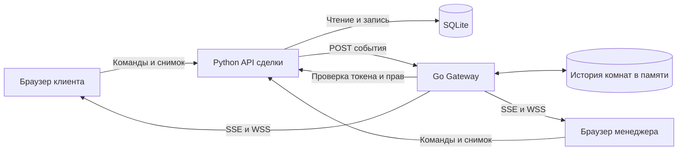
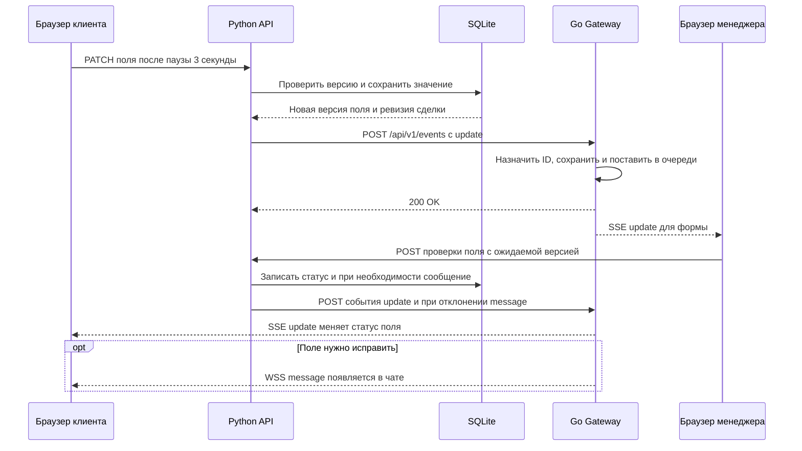

# Архитектура Real-time Gateway на WSS и SSE

Прототип принимает события от внутренних сервисов по HTTP и доставляет их браузерам, подписанным на нужные комнаты. Демо показывает совместную работу клиента и менеджера на экране выкупа автомобиля. Оба входят по одному `dealId` и получают события одной комнаты. Это самостоятельный сценарий на синтетических данных.

## Компоненты и границы ответственности

| Компонент | Что делает | Что хранит |
| --- | --- | --- |
| **Go Gateway** | Принимает публикации, проверяет права, ведёт комнаты, раздаёт события по WSS и SSE и восстанавливает поток по курсору. Один процесс. REST и SSE на `net/http`, WebSocket на `github.com/coder/websocket`. | Подписки, очереди подключений, краткую историю событий и одноразовые WSS-билеты в памяти. |
| **Python API сделки** | FastAPI проверяет участников, принимает изменения формы и сообщения, управляет статусами, выдаёт снимок сделки и публикует события в Gateway. Здесь же мок авторизации для демо. | SQLite хранит сделки, роли участников, значения и статусы полей, сообщения и метаданные вложений. |
| **Статический веб-клиент** | Одна HTML/CSS/JS-страница. Слева форма сделки, справа чат. `fetch` отправляет действия в Python, `EventSource` обновляет форму, `WebSocket` обновляет чат. | Текущий снимок, несохранённый ввод и курсоры открытых потоков. |

Gateway работает с универсальными `room`, `event_type` и `payload`. Любой продюсер с нужными правами может отправлять собственные типы событий. Только Python и демо-клиент знают, что в этом сценарии `room = dealId` и как интерпретировать `update` и `message`. [Go HTTP](https://pkg.go.dev/net/http), [Coder WebSocket](https://pkg.go.dev/github.com/coder/websocket), [FastAPI](https://fastapi.tiangolo.com/).



## Сценарий сделки

Клиент и менеджер открывают одну страницу в двух вкладках, входят под разными демо-учётками и вводят один `dealId`. Форма может содержать около десяти полей. Для первого сквозного сценария достаточно `horsePower`, `engineVolume` и `paintColour`.

| Действие | Проверка и изменение в Python | Что получают браузеры |
| --- | --- | --- |
| Клиент вводит значение | Браузер отправляет изменение через 3 секунды после последнего ввода. Python проверяет, что сделка открыта, поле доступно для редактирования и версия поля актуальна. | `update / field.value` обновляет конкретное поле по `dealFieldName`. |
| Менеджер подтверждает поле | Менеджер видит значения в режиме чтения и проверяет конкретную версию. Python ставит `approved` и блокирует редактирование клиентом. | `update / field.review` меняет статус на «Подтверждено». |
| Менеджер просит исправить поле | Python ставит `needs_correction`, разблокирует поле и сохраняет системное сообщение «Исправьте значение: Цвет автомобиля» в той же транзакции. | `update / field.review` подсвечивает поле, `message` добавляет запись в чат. |
| Любой участник отправляет сообщение | Python сохраняет сообщение и метаданные вложений. Вложения в демо — синтетические изображения документов. Содержимое файла выдаёт Python по проверяемому URL. | `message` передаёт текст и список вложений с ID, именем и URL. |
| Клиент завершает выкуп | Python повторно проверяет, что обязательные поля заполнены и подтверждены, и переводит сделку из `draft` в `buyout_completed`. | `update / deal.status` открывает менеджеру кнопку «Принять на склад». |
| Менеджер принимает автомобиль на склад | Только менеджер может перевести `buyout_completed` в `in_stock`. | `update / deal.status` завершает демо. |

При сохранении исправленного значения Python возвращает поле на проверку со статусом `pending`. Клиент отключает кнопку завершения, пока есть неподтверждённые поля или ожидающие отправки изменения. Сервер повторно проверяет права и условия перехода при каждой команде.

## Данные и API сделки

Минимальные сущности SQLite. `deals` хранит статус и возрастающую `revision` сделки. `deal_members` связывает учётки со сделкой и ролью. `deal_fields` хранит значение, статус и версию конкретного поля. `messages` хранит автора, текст и ID, `attachments` связывает метаданные файла с сообщением. Изменение состояния и увеличение `revision` происходят в одной транзакции. Версия поля меняется при изменении его значения или статуса.

| Маршрут Python | Вход и результат |
| --- | --- |
| `POST /api/demo/sessions` | Учётные данные демо-пользователя → короткоживущий токен. Роль определяется членством в конкретной сделке. |
| `GET /api/deals/{dealId}` | Согласованный снимок с `revision`, ролью текущего участника, статусом, полями и сообщениями. |
| `PATCH /api/deals/{dealId}/fields/{fieldName}` | Клиент передаёт `value` и `expectedVersion`. |
| `POST /api/deals/{dealId}/fields/{fieldName}/review` | Менеджер передаёт `decision` (`approve` или `request_correction`) и `expectedVersion`. |
| `POST /api/deals/{dealId}/messages` | Текст и необязательные файлы через `multipart/form-data`. Участники читают вложения через `GET /api/deals/{dealId}/attachments/{attachmentId}`. |
| `POST /api/deals/{dealId}/complete-buyout` и `POST /api/deals/{dealId}/accept-to-stock` | Переходы состояния от клиента и менеджера соответственно. |

Браузер передаёт токен в `Authorization: Bearer …`. Python отвечает `403` за недоступное действие или чужую сделку и `409` за устаревшую версию поля или недопустимый переход. При конфликте браузер перечитывает данные. Так менеджер не подтвердит значение, которое клиент успел заменить.

Python публикует событие **после** сохранения изменения. В одной копии демо-сервиса обработка записи и отправка событий сериализуются по `dealId`. Это сохраняет порядок публикаций, включая пару «статус поля и системное сообщение». Если Gateway недоступен, Python возвращает результат сохранения и `liveDelivery: "degraded"`. Отправитель видит, что обновление сохранено, и может перечитать снимок. В остальных вкладках пропущенные при публикации изменения появятся при следующей синхронизации с Python. Если нужна гарантированная повторная отправка между сервисами, следующий шаг — записывать исходящие события в outbox в той же транзакции.

## Контракт Gateway

| Интерфейс | Контракт |
| --- | --- |
| `POST /api/v1/events` | Принимает `room`, `event_type` и JSON-объект `payload` от продюсера с правом публикации. `200` подтверждает приём шлюзом, `400` — ошибка запроса, `403` — отсутствие прав, `500` — ошибка шлюза с записью в журнал. |
| `GET /ws` | WSS-клиент подписывается командой `{"action":"subscribe","room":"deal-42","last_event_id":"g7:deal-42:41"}`. Курсор необязателен. Поддерживаются несколько комнат, `unsubscribe` и ping/pong. Отказ после установки соединения приходит JSON-ответом с `code: 403`. |
| `GET /sse?room=deal-42&token=…` | Поток `text/event-stream` для одной комнаты. Каждое событие включает `id` и `data` с общим JSON. При автоматическом переподключении `EventSource` передаёт `Last-Event-ID`. Для нового экземпляра можно передать `last_event_id` в URL. При наличии обоих значений заголовок имеет приоритет. |

В ТЗ есть две трактовки обязательности `room`. Для прототипа предложено сохранить правило из черновика. Отсутствующее поле означает broadcast в уже известные шлюзу комнаты и требует отдельного разрешения. `null` и пустая строка дают `400`. Python публикует события сделки только с явным `room`. Комнату можно создать по первой разрешённой подписке или публикации, поэтому ввод нового `dealId` не требует правки конфига.

### Примеры событий

Python передаёт `room`, `event_type` и `payload`. Go добавляет `id` и `created_at` при принятии. Ниже показан формат на выходе Go, одинаковый для двух транспортов.

```json
{
  "id": "g7:deal-42:42",
  "room": "deal-42",
  "event_type": "update",
  "payload": {
    "kind": "field.value",
    "dealFieldName": "paintColour",
    "value": "Синий",
    "status": "pending",
    "fieldVersion": 3,
    "revision": 17
  },
  "created_at": "2026-11-18T12:00:00Z"
}
```

Для `field.review` в `payload` идут имя поля, новый статус, `fieldVersion` и `revision`. Для `deal.status` — новый статус сделки и `revision`. Клиент обрабатывает по одному полю или статусу без перезагрузки страницы.

```json
{
  "id": "g7:deal-42:43",
  "room": "deal-42",
  "event_type": "message",
  "payload": {
    "messageId": "msg-43",
    "senderRole": "client",
    "text": "Прикрепляю фото документа",
    "attachments": [
      {
        "id": "att-1",
        "fileName": "demo-sts.jpg",
        "url": "/api/deals/deal-42/attachments/att-1"
      }
    ],
    "revision": 18
  },
  "created_at": "2026-11-18T12:00:05Z"
}
```

При загрузке файла браузер использует URL относительно Python API и передаёт токен в запросе. Для сообщения об исправлении поля `senderRole` равно `system`, `attachments` — пустой массив. Два события одной операции могут иметь общую `revision`, но разные `id` шлюза.

### Авторизация и браузер

- Go обращается к внутреннему `POST /internal/auth/validate` по сервисному секрету. Мок в Python принимает `token` и возвращает `subject`, `expires_at`, списки `subscribe_rooms` и `publish_rooms`, разрешение `allow_broadcast`. Проверка в Python защищает чтение и изменение сделки, проверка в Go — подписку и публикацию. Продюсер использует отдельный сервисный токен, который хранится на сервере.
- Небраузерный WSS-клиент передаёт `Authorization` при подключении. Браузерный `WebSocket` не позволяет задавать этот заголовок, поэтому браузер получает короткоживущий одноразовый билет через `POST /api/v1/ws-tickets` с Bearer-токеном и открывает `/ws?ticket=…`. Gateway проверяет билет и `Origin` при подключении, затем право на комнату при каждой подписке. [Стандарт WebSocket](https://websockets.spec.whatwg.org/#the-websocket-interface).
- SSE проверяет токен из `token` и доступ в комнату до открытия ответа. Когда срок доступа истекает, шлюз закрывает активные потоки. Браузер обновляет демо-сессию и использует сохранённые курсоры, для WSS также запрашивает свежий билет. Gateway и прокси исключают токены, билеты и содержимое документов из логов. В браузерном журнале демо показываются сообщения WSS после подключения. [Стандарт SSE](https://html.spec.whatwg.org/multipage/server-sent-events.html).

## От публикации до экрана

Клиент и менеджер уже подписаны на комнату. На обоих протоколах Gateway доставляет один общий поток событий, а экран применяет `update` из SSE и `message` из WSS. Каждый поток продвигает свой курсор по всем полученным ID, включая события, которые экран в этом потоке пропускает.



## Порядок и восстановление

- **Go задаёт FIFO в каждой комнате.** Ядро за одну операцию выдаёт возрастающий номер, сохраняет запись и ставит её в очереди подписчиков. Адаптеры последовательно отправляют данные, сетевые записи проходят вне блокировки комнаты. Очереди ограничены. При переполнении шлюз отключает медленного подписчика, остальные продолжают получать события.
- **История ограничена TTL и количеством.** Начальные значения — 10 минут и до 100 событий на комнату. Go отбрасывает устаревшие записи при чтении и периодически очищает память. Позиция содержит поколение истории, комнату и номер. Поколение меняется при перезапуске или удалении комнаты из памяти. `200` означает приём шлюзом. Повторно прочитать событие можно, пока нужный диапазон хранится в памяти.
- **Первый вход.** Подписка без курсора начинается с текущей позиции. Go отправляет `ready` с этой позицией, в SSE она идёт в поле `id`. Браузер дожидается `ready` на обоих потоках и буферизует входящие события до получения `GET /api/deals/{dealId}`. Затем применяет события с `revision` выше ревизии снимка. Порог берётся из снимка отдельно для каждого потока, поэтому обновление формы и сообщение с одной ревизией применяются оба. Сообщения обновляются по `messageId`, поля — по `fieldVersion`.
- **Короткий обрыв.** SSE передаёт `Last-Event-ID`, WSS переподключается и отправляет `last_event_id` для каждой комнаты. Go ставит в очередь сохранённые записи после курсора и регистрирует подписчика атомарно относительно публикаций. Новые события идут следом. Дубликаты после повторной доставки браузер отбрасывает по `id` в пределах потока.
- **Пропуск в истории.** Если часть событий вытеснена, поколение сменилось или курсор нельзя применить, Go отправляет `resync_required`. Экран закрывает оба потока и повторяет процедуру первого входа. SQLite отдаёт актуальные поля, статусы и чат даже после перезапуска Gateway.

Модули Go следуют ТЗ. `api` обрабатывает публикации, `rooms` и `history` реализуют порядок, подписки и восстановление, `auth` проверяет права, `ws` и `sse` адаптируют транспорт. При нескольких экземплярах Gateway понадобится общий упорядоченный журнал, например Redis Streams. Для демо достаточно одного процесса и истории в памяти.

## Сборка и проверка

GitHub Actions проверяет Go и Python на PR. После merge в `main` Pages публикует HTML/CSS/JS. Для полного сценария Go и Python доступны отдельно по HTTPS. Прокси пропускает WebSocket Upgrade и отключает буферизацию SSE. Python и Gateway разрешают CORS для точного origin демо, WSS проверяет этот origin при установке соединения. Базовые адреса сервисов задаются в конфигурации веб-клиента. Сервисные ключи остаются на сервере. [Документация GitHub Pages](https://docs.github.com/en/pages/getting-started-with-github-pages/what-is-github-pages).

| Владелец | Первый проверяемый результат |
| --- | --- |
| Михаил Иванов | Go Gateway принимает POST и доставляет события двум подписчикам одной комнаты. Затем подключает SSE, FIFO и восстановление. |
| desmodadi | Python создаёт тестовую сделку с двумя ролями, отдаёт снимок и сохраняет изменение поля. Затем добавляет статусы, чат, вложения и мок авторизации. |
| rewhed | Страница открывается в двух ролях, CI проверяет оба сервиса, GitHub Pages публикует фронтенд после merge. |

Проверки для сдачи:

1. Две вкладки входят в `deal-42`. Изменение поля появляется у менеджера после паузы 3 секунды, сообщение — в чате. Журнал показывает WSS-сообщения без хендшейка.
2. Менеджер подтверждает поле, затем просит исправить. Клиент сначала теряет возможность редактировать поле, потом получает её обратно и видит системное сообщение. Сервер отклоняет обход ограничений через API.
3. Клиент видит кнопку завершения только после проверки обязательных полей. После завершения менеджер может принять машину на склад. Вкладка без доступа к сделке не видит её данные и события.
4. После короткого обрыва SSE и WSS восстанавливаются каждый по своему курсору. При вытеснении нужных событий или перезапуске Gateway экран восстанавливается из снимка.
5. В Go тестируются порядок, TTL, лимит истории, несколько комнат WSS и отказы в подписке. Интеграционный тест отправляет один POST и сверяет ID в обоих транспортах. Для отдельной проверки по ТЗ в демо предусмотрены управление подключениями, журнал и кнопка тестовой публикации через демо API.
