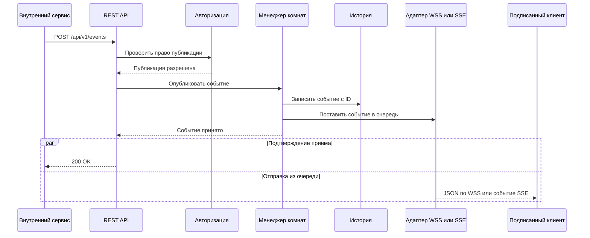

# Архитектура Real-time Gateway на WSS и SSE

Шлюз принимает события от внутренних сервисов по HTTP и доставляет их веб-клиентам, подписанным на нужные комнаты. Прототип работает в одном процессе, хранит краткую историю в памяти и поддерживает два клиентских интерфейса — WebSocket поверх TLS (WSS) и Server-Sent Events (SSE).

## Три тезиса

1. **Единое ядро для двух протоколов.** WSS подходит для двустороннего обмена и управления несколькими подписками в одном соединении. SSE подходит для одностороннего потока обновлений, например для дашборда.
2. **Комната задаёт границу доступа.** Шлюз проверяет права отправителя при публикации и права получателя при подписке. Рассылка во все комнаты требует отдельного разрешения.
3. **Краткая история помогает пережить обрыв связи.** Клиент продолжает с последнего обработанного идентификатора. Шлюз выдаёт сохранённые события в порядке публикации и сообщает клиенту, когда восстановить пропуск уже невозможно.

## Компоненты и технологии

Для прототипа — TypeScript и Node.js, Express для REST и SSE, `ws` для WebSocket. Демо-страница использует браузерные `WebSocket`, `EventSource` и `fetch`. Зависимости фиксируются в `package-lock.json`. TLS завершается на прокси, который поддерживает WebSocket Upgrade и отключает буферизацию ответов для SSE.

| Модуль | Ответственность |
| --- | --- |
| `api` | Принимает и валидирует события, проверяет право публикации, вызывает `rooms.publish`. |
| `rooms` | Ведёт каталог комнат и подписки, упорядочивает публикации, передаёт события в очереди соединений. |
| `history` | Хранит события по комнатам, удаляет устаревшие записи, возвращает события после указанного ID. |
| `auth` | Проверяет токены через мок-сервис, возвращает права на чтение комнат, публикацию и общую рассылку. |
| `ws` | Обрабатывает WSS-подключение, команды подписки и отписки, ping/pong и отправку JSON. |
| `sse` | Открывает поток для одной комнаты, кодирует SSE-события, обрабатывает переподключение. |

Каталог комнат задаётся конфигурацией. Пример конфигурации включает порт, список комнат, URL мок-сервиса авторизации, TTL истории (10 минут), лимит записей (100 на комнату) и размер очереди соединения. При остановке или разрыве соединения адаптер удаляет подписки и освобождает ресурсы. Очередь каждого клиента ограничена. При её переполнении шлюз разрывает соединение медленного клиента, который может продолжить чтение после переподключения.

## Контракты API

- **Публикация — `POST /api/v1/events`.** Отправитель передаёт Bearer-токен и JSON с полями `room`, `event_type` и `payload`. Непустая `room` должна присутствовать в каталоге. Отсутствие поля означает публикацию по одному событию в каждую комнату каталога и требует права на общую рассылку. Явные `null` и пустая строка считаются ошибкой. Клиент, подписанный на несколько комнат, получит отдельное событие для каждой из них. Ответ `200` подтверждает приём шлюзом. Невалидный запрос получает `400`, отказ в доступе — `403`, внутренняя ошибка — `500` с записью в журнал.
- **WebSocket — `wss://host/ws`.** Внешний клиент передаёт `Authorization: Bearer …` при установке соединения. Команда `{"action":"subscribe","room":"orders","last_event_id":"…"}` оформляет подписку, а `unsubscribe` снимает её. Курсор необязателен и передаётся отдельно для каждой комнаты. После открытия соединения отказ в подписке передаётся JSON-сообщением с кодом `403`.
- **SSE — `https://host/sse?room=orders&token=…`.** Сервер проверяет доступ до открытия потока и возвращает `text/event-stream`. Поле `id` содержит идентификатор события, поле `data` — тот же JSON, что передаётся по WSS. При автоматическом переподключении `EventSource` передаёт заголовок `Last-Event-ID`. Если приложение создаёт новый экземпляр `EventSource`, сохранённый курсор можно передать через `last_event_id` в URL. Заголовок имеет приоритет. Прокси и приложение исключают параметры с токеном из журналов. [Спецификация SSE](https://html.spec.whatwg.org/multipage/server-sent-events.html)
- **Демо в браузере.** Браузерный конструктор `WebSocket` не позволяет задать заголовок `Authorization`. Для демо на том же домене шлюз обменивает введённый токен на короткую сессию через HTTPS. При открытии WSS он проверяет сессионную cookie (`HttpOnly`, `Secure`, `SameSite=Strict`) и разрешённый `Origin`. Для тестового POST демо использует отдельный токен с правом записи только в демо-комнату. [Спецификация WebSocket](https://websockets.spec.whatwg.org/#the-websocket-interface)

Общий формат события для обоих транспортов:

```json
{
  "id": "g7:orders:42",
  "room": "orders",
  "event_type": "order.created",
  "payload": { "order_id": 123, "status": "new" },
  "created_at": "2026-11-12T12:00:00Z"
}
```

## Порядок событий и восстановление

Идентификатор содержит поколение хранилища, комнату и возрастающий номер события в комнате. В одном процессе ядро без асинхронных пауз назначает номер, записывает событие в историю и добавляет его в очереди подписчиков. Адаптеры последовательно опустошают очереди. При подписке с курсором ядро за одну операцию ставит в очередь сохранённые события после курсора и регистрирует подписчика, поэтому новые события идут следом за историей.

Если курсор отсутствует, подписка начинается с текущей позиции. Шлюз передаёт её клиенту в служебном сообщении `ready`. Для SSE позиция записывается в поле `id`. При повторной доставке клиент может отбросить событие по его ID. Если часть пропуска уже вытеснена по TTL или лимиту либо шлюз перезапустился, адаптер возвращает служебное сообщение `resync_required`. Клиент заново загружает состояние из исходного сервиса, если оно доступно, и открывает новую подписку. Демо показывает сообщение о потере истории. Гарантия FIFO действует в пределах одной комнаты, а восстановление — в пределах сохранённой истории.

При горизонтальном масштабировании общий журнал событий, например Redis Streams, должен хранить последовательность и историю по каждой комнате. Каждый экземпляр шлюза читает журнал для своих подписчиков и держит их соединения локально. Публикация и выдача истории используют один порядок из общего журнала.

## Диаграмма доставки события

Подписчик уже подключён и прошёл проверку доступа. При отказе на публикацию REST API отвечает ошибкой и завершает обработку до записи в историю.



## Задачи на трёх разработчиков

| Разработчик | Задачи | Результат и проверка |
| --- | --- | --- |
| **1. REST и ядро доставки** | Настроить проект, конфигурацию и обработку ошибок запуска. Реализовать `api`, `rooms`, `history`, FIFO, TTL и рассылку. | REST API и общее ядро. Модульные тесты на порядок публикаций, маршрутизацию, очистку истории и подключение с курсором. |
| **2. WSS и авторизация** | Реализовать `auth` и мок-сервис. Сделать WSS-адаптер, команды подписки и отписки, ping/pong и возобновление по комнате. Подключить авторизацию к REST и передать общий интерфейс разработчику SSE. Реализовать браузерную сессию для демо WSS. | Подключение к нескольким комнатам по WSS. Тесты проверки токена и прав, в том числе отказа в подписке и общей рассылке. |
| **3. SSE и демонстрация** | Реализовать SSE-адаптер с проверкой прав, heartbeat и обработкой `Last-Event-ID`. Собрать демо с двумя панелями, вводом токена и комнаты, кнопками подключения, отключения и тестовой публикации, а также журналом событий. Подготовить документацию API и README. | SSE-поток, рабочее демо и интеграционные тесты для обоих транспортов. README содержит запуск, пример настроек и статус шести этапов ТЗ. |

**Порядок интеграции.** Сначала команда согласует JSON события и контракты `publish`, `subscribe`, `unsubscribe` и проверки прав. Затем разработчики WSS и SSE работают параллельно с заглушками этих интерфейсов. После подключения ядра команда проверяет доставку одного POST в оба транспорта, запрет доступа к чужой комнате, несколько одновременных подписок, FIFO, восстановление после обрыва, истечение истории и ответы на ошибки. Для сдачи команда собирает код, тесты, документацию, пример конфигурации и лицензию MIT в публичном репозитории GitHub.
